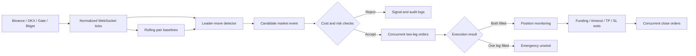

# Cross-Exchange Perpetual Swap Spread Arbitrage System

An event-driven Python system for researching and executing hedged long-short positions in the same USDT-margined perpetual futures across Binance, OKX, Gate, and Bitget.

The system tracks temporary deviations from rolling cross-venue equilibrium spreads following leading-venue price moves. Signals, execution feasibility, position management, and capital allocation are handled as separate stages so that a detected market event does not become an order without cost and risk checks.

> Research software for educational use. This repository does not provide investment advice or claim that the strategy is profitable.

## System at a glance

| Layer | Implemented behavior | Main modules |
|---|---|---|
| Signal model | Rolling-median equilibrium spreads, leader-move confirmation, residual direction checks, warm-up, and signal cooldowns | `tracker/baseline.py`, `tracker/signal_detector.py` |
| Market-data path | Dynamic selection of liquid contracts shared by four venues; normalized WebSocket ticks processed in memory on an `asyncio` event loop | `tracker/symbol_selector.py`, `tracker/ws_feed.py`, `tracker/tracker.py` |
| Execution and risk | Order-book-aware cost estimation, contract normalization, concurrent two-leg orders, asymmetric-fill recovery, lifecycle exits, exposure limits, and capital rebalancing | `trader/`, `rebalance/` |
| Validation and operation | Public-data mode, demo/testnet workflows, authenticated live reads, explicit live-mode confirmation, and exchange-facing integration checks | `test_demo/`, `test_live/`, `main.py` |

## System architecture



The public tick path runs in one Python process without a database, message broker, or external cache. Authenticated REST clients handle contract metadata, balances, funding rates, orders, and transfers. See [Architecture](docs/ARCHITECTURE.md) for component boundaries and execution sequences.

## Research model

For leader venue `L`, follower venue `F`, and symbol `s`, the instantaneous spread in basis points is:

```text
S_t = 10^4 * (P_t^L - P_t^F) / P_t^F
```

A rolling median provides the equilibrium spread `B_t`. The detector evaluates the residual:

```text
A_t = S_t - B_t
```

This separates temporary dislocations from persistent venue premia. A market event requires:

1. a leader return above the configured threshold within `LEADER_WINDOW_MS`;
2. a residual deviation above `ANOMALY_MIN_PCT`;
3. agreement between the leader move and residual direction;
4. completion of the baseline warm-up period and direction-specific cooldown.

The detector records a market observation rather than an order instruction. Execution feasibility is evaluated separately.

## Execution and risk controls

Controls are applied at different stages of the position lifecycle:

| Stage | Implemented checks and responses |
|---|---|
| Candidate evaluation | Taker fees for entry and exit, expected funding, depth-walk or BBO-derived slippage, contract multipliers, quantity steps, minimum size, minimum notional, and minimum expected net ROI |
| Entry admission | Per-exchange available balance, position limits by pair and symbol, symbol-notional concentration, order-rate limits, daily-loss state, stop-loss suspension, failure cooldown, and rebalance pause |
| Two-leg execution | Concurrent order submission, per-leg result reconciliation, immediate reversal attempt after a one-leg fill, and failure counting when execution is incomplete |
| Position monitoring | Actual entry fills, current cross-venue prices, unfavorable funding near settlement, maximum holding time, take-profit, and stop-loss conditions |
| Exit and recovery | Concurrent close orders, critical reporting of residual exposure after a close-leg failure, account and position inspection tools, and loading of matched live positions at startup |
| Capital allocation | Periodic exchange-balance refresh, venue-level close-only behavior when available capital is insufficient, cash-distribution checks, fee-aware transfer routing, and entry suspension during rebalancing |

These controls reduce avoidable execution and concentration risks but do not make two-venue orders atomic. Network failures, venue outages, rejected orders, or partial execution can still leave temporary directional exposure and require operator review.

## Repository structure

```text
.
├── main.py                  # Process lifecycle and live-mode preflight
├── tracker/                 # Market data, universe, baselines, and signals
├── trader/                  # Cost model, execution, positions, and risk
├── rebalance/               # Cash-distribution checks and transfer planning
├── clients/                 # Venue URLs, symbol mapping, credential templates
├── test_demo/               # Demo/testnet integration checks
├── test_live/               # Live read-only and explicitly confirmed checks
├── tools/                   # Account, cash-flow, and recovery utilities
├── server/                  # Deployment and synchronization helpers
└── docs/                    # Architecture and operating documentation
```

## Quick start

### 1. Create an environment

```bash
python -m venv .venv
source .venv/bin/activate       # Linux/macOS
# .venv\Scripts\Activate.ps1  # Windows PowerShell
pip install -r requirements.txt
```

Python 3.10 or newer is required.

### 2. Configure demo credentials

Copy `clients/api_keys_demo.example.py` to `clients/api_keys_demo.py` and supply demo/testnet credentials. Local credential files are excluded by `.gitignore`. See [Configuration](CONFIG_GUIDE.md).

### 3. Validate before running

```bash
python -m test_demo.run_all --skip-orders
python -m tracker
python main.py
```

The default application mode uses demo/testnet configuration. Live mode performs a read-only preflight and requires an exact `YES` confirmation:

```bash
python main.py --live
```

Read [Operations and validation](docs/OPERATIONS.md) before using live commands. Some utilities can place orders, transfer assets, or request withdrawals.

## Default configuration

| Concern | Checked-in default |
|---|---:|
| Baseline warm-up / window | 60 s / 2,000 ticks |
| Leader window / move threshold | 1,000 ms / 0.3% |
| Minimum anomaly | 0.5% |
| Capital per pair | 1% of minimum futures balance, both legs combined |
| Leverage | 1x |
| Take-profit / stop-loss | 0.20% / 8.0% combined position PnL |
| Maximum holding time | 8 h |
| Daily balance halt | below 95% of day-start balance |

The source of truth is `tracker/config.py` and `trader/config.py`. These values are runtime defaults, not empirical results.

## Validation scope

The included checks are exchange-facing integration checks rather than a hermetic unit-test suite. They cover demo account, position, order, cancellation, and transfer flows; live connectivity, account, order-book, contract, and funding reads; and explicitly confirmed live order or transfer paths.

Results depend on exchange availability, credentials, permissions, clock synchronization, network region, and account state. A successful integration run does not establish strategy profitability.

The system was developed with separate testnet and live-trading workflows and was used for small-scale live validation. Account identifiers, balances, credentials, and transaction records are not published.

## Module guides

- [Market data and signal generation](tracker/README.md)
- [Execution, positions, and risk](trader/README.md)
- [Exchange configuration and credentials](clients/README.md)
- [Capital rebalancing](rebalance/README.md)
- [Validation suites](test_demo/README.md)
- [Operational utilities](tools/README.md)

## Documentation

- [Architecture and design boundaries](docs/ARCHITECTURE.md)
- [Operations and validation](docs/OPERATIONS.md)
- [Configuration and credential handling](CONFIG_GUIDE.md)
- [Command reference](COMMANDS.md)
- [Security policy](SECURITY.md)

## Limitations

- The baseline and thresholds are heuristic online statistics.
- Regime shifts, thin order books, network latency, venue outages, and API changes can invalidate assumptions.
- Temporary one-sided exposure cannot be eliminated because the exchanges do not provide a shared transaction boundary.
- File-based records do not provide transactional persistence or distributed recovery.
- The repository does not include a historical backtester, formal latency benchmark, public profitability report, or production service-level guarantee.

## License

No open-source license has been declared. All rights remain with the repository owner.
