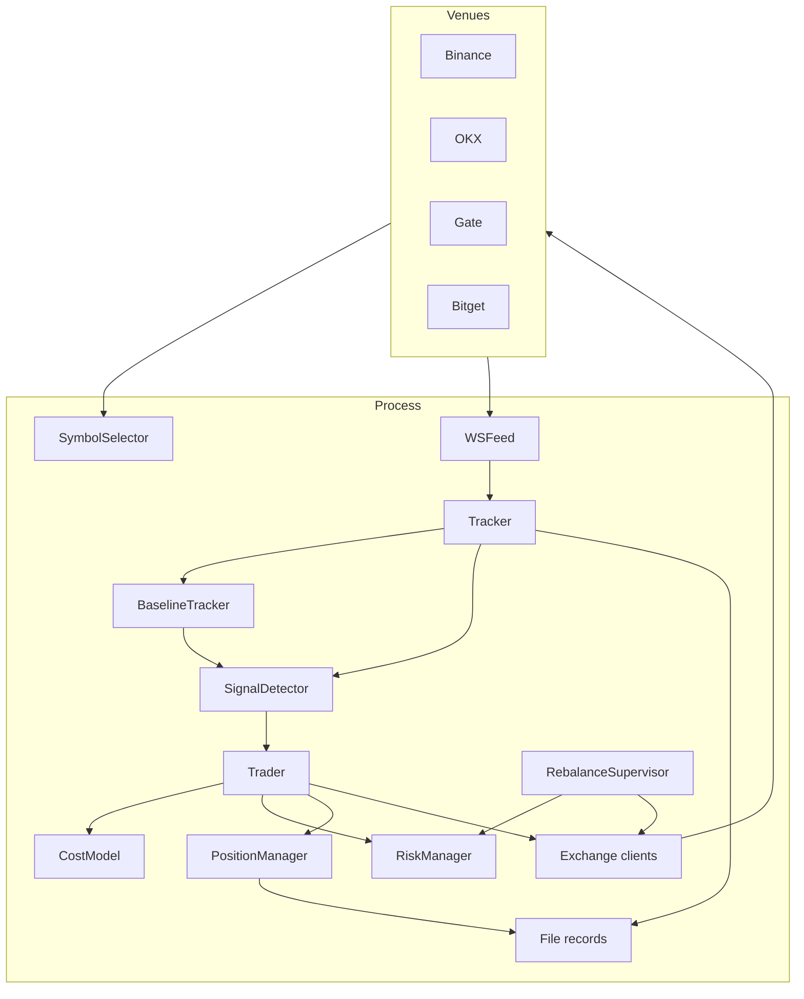
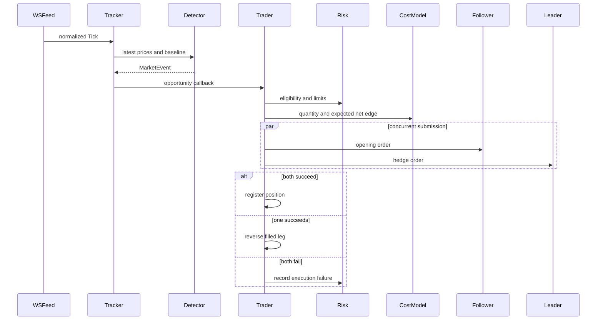

# Architecture

[Project overview](../README.md) · [Operations](OPERATIONS.md) · [Configuration](../CONFIG_GUIDE.md)

This document describes the checked-in implementation and separates system behavior from unmeasured trading outcomes.

## Context

The system runs as one Python process on an `asyncio` event loop. It connects directly to Binance, OKX, Gate, and Bitget through public WebSocket/REST endpoints and authenticated REST endpoints. No database, broker, or external cache sits on the signal path.

The single event loop keeps state coordination direct. Synchronous work on the tick path must remain short; network operations are scheduled as asynchronous tasks.

## Component boundaries

| Component | Responsibility | Out of scope |
|---|---|---|
| `clients/` | Endpoints, exchange lists, symbols, credential loading | Trading policy |
| `tracker/symbol_selector.py` | Shared liquid instrument universe | Position sizing |
| `tracker/ws_feed.py` | Connections, parsing, normalization, reconnects | Signal interpretation |
| `tracker/baseline.py` | Rolling spread state and warm-up | Order decisions |
| `tracker/signal_detector.py` | Leader history, anomaly rules, cooldowns | Transaction costs |
| `tracker/tracker.py` | Market-data orchestration and callbacks | Authenticated execution |
| `trader/cost_model.py` | Fees, funding, slippage, quantity feasibility | Order transport |
| `trader/exchange_client.py` | Venue-specific authenticated REST operations | Cross-venue policy |
| `trader/risk.py` | Halts, limits, cooldowns, balance state | Signal generation |
| `trader/position_manager.py` | Position registry and trade records | Market-data collection |
| `trader/trader.py` | Entry, exit, and failure recovery | Raw feed parsing |
| `rebalance/` | Cash distribution, route planning, transfers | Alpha signal |

## Market-data and signal path

1. `SymbolSelector` ranks Binance USDT perpetuals by reported 24-hour volume, intersects the result with the other active venues, and applies the minimum-volume filter.
2. `WSFeed` converts venue payloads into `Tick(exchange, symbol, bid, ask, mid, ts_ns)`.
3. `Tracker` stores the latest observations, updates pair baselines, and evaluates signals after warm-up.
4. `BaselineTracker` maintains bounded rolling spread histories.
5. `SignalDetector` checks leader returns, baseline residuals, direction agreement, and cooldown state.
6. A `MarketEvent` is passed to the trader callback; it is not itself an instruction to trade.

Direct in-process callbacks avoid a queue on the normal signal path. This is a latency-oriented design choice, not a measured latency guarantee.

## Entry sequence

The cost model incorporates configured taker fees, expected holding-period funding, BBO-derived slippage, contract multipliers, quantity precision, and minimum notionals.

## Position lifecycle

Positions store both legs, including venue, side, quantity, notional, order identifier, and actual fill information. Live startup queries existing exchange positions and loads matched leader-follower exposure into the monitoring path.

Protection layers overlap:

- incoming ticks trigger position checks;
- a periodic sweep re-evaluates positions from cached prices;
- reconnect callbacks request a position scan;
- a timer enforces the maximum holding period.

The current exit order is unfavorable funding near settlement, timeout, take-profit, and stop-loss. Close orders are submitted concurrently. A close-leg failure is logged as a critical event because residual exposure may remain.

## Risk and capital state

`RiskManager` maintains process-level controls independently of signal generation:

- daily balance halt and exit after positions are flat;
- entry suspension after a stop-loss until UTC midnight;
- maximum positions per pair and symbol;
- maximum symbol notional relative to equity;
- per-exchange order-rate limits;
- cooldown after consecutive failures;
- balance and cash-ratio conditions used by rebalancing.

## Persistence and observability

| Artifact | Purpose |
|---|---|
| `logs/params.json` | Configuration snapshot |
| `logs/signals.csv` | Candidate market events |
| `logs/spread_snapshots.csv` | Spread and baseline observations |
| `logs/trades.csv` | Position lifecycle records |
| `logs/main.log`, `logs/tracker.log` | Operational events and failures |

Generated records are excluded from version control. File-based storage is transparent for a single-process research system but does not provide transactional persistence or multi-process coordination.

## Design boundaries

| Choice | Operational benefit | Boundary |
|---|---|---|
| One event loop | Direct in-memory coordination | CPU-heavy work can delay other tasks |
| Rolling median | Resistance to isolated spread spikes | Fixed windows adapt imperfectly to regime shifts |
| Direct callback | No queue backlog on the normal path | Callback work must remain short |
| Concurrent two-leg submission | Avoids deliberate sequential delay | Cannot create cross-venue atomicity |
| File records | Easy inspection and low dependency count | No transactional recovery guarantee |
| Common client interface | Central policy with localized venue logic | Exchange schema changes require maintenance |

Possible research extensions include alternative robust baselines, volatility-conditioned thresholds, replay adapters that emit `Tick` objects, calibrated slippage models, and structured metrics exporters. They are not implemented features.
